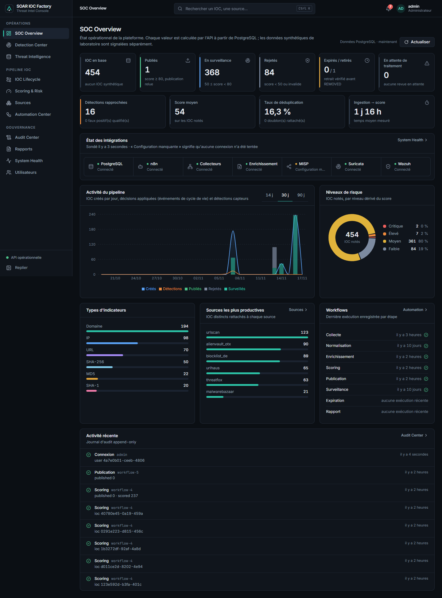
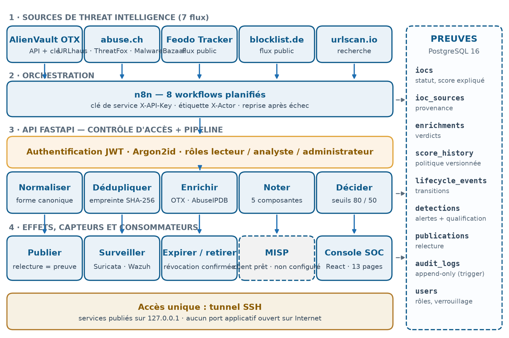
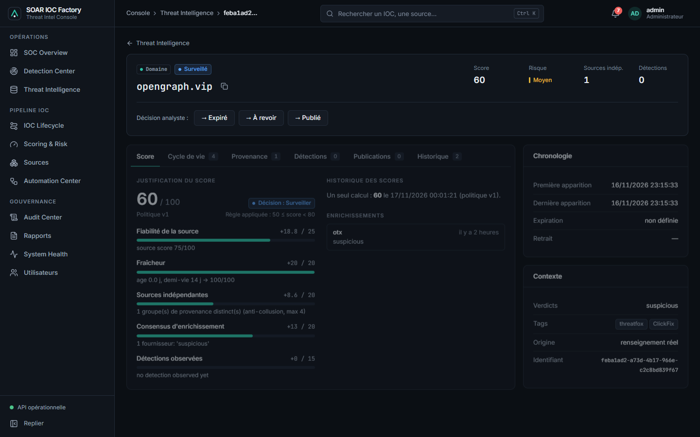
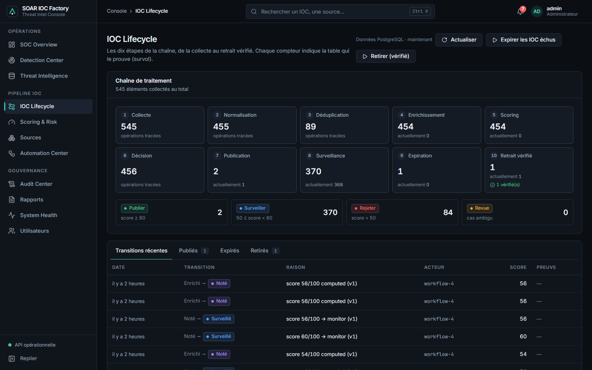
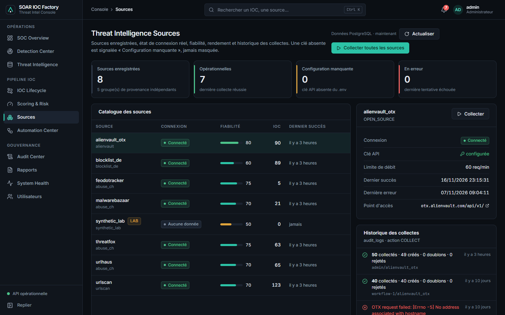
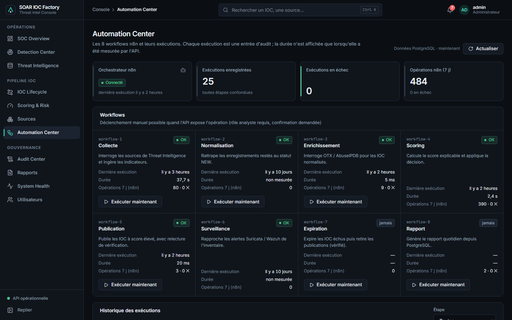
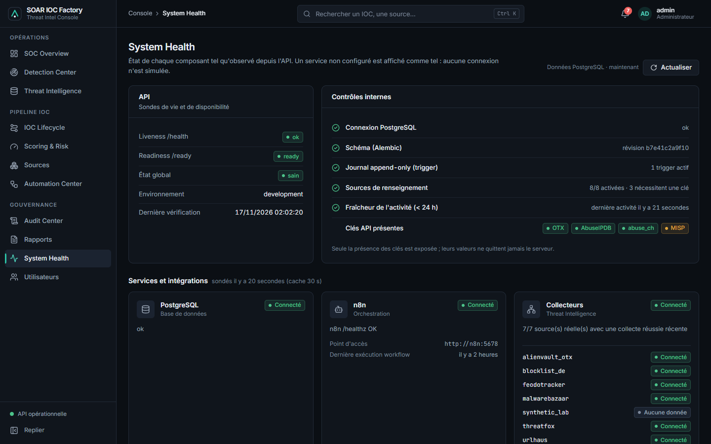

# SOAR IOC Factory




> Usine à indicateurs de compromission : **collecter → normaliser → dédupliquer →
> enrichir → noter → décider → publier → surveiller → expirer → retirer**,
> avec preuve, journal d'audit et console SOC.

Projet 3 — plateforme SOAR de gestion automatisée du cycle de vie des IOC, avec
son automatisation n8n, ses intégrations SOC (Suricata, Wazuh, MISP), son
contrôle d'accès par rôles, son déploiement AWS et son évaluation mesurée.

**Livrables** : rapport de projet [`reports/RAPPORT_SOAR_IOC_FACTORY_PROJET.docx`](reports/RAPPORT_SOAR_IOC_FACTORY_PROJET.docx)
(29 pages, [PDF](reports/RAPPORT_SOAR_IOC_FACTORY_PROJET.pdf)) · soutenance
[`reports/PRESENTATION_SOAR_IOC_FACTORY_PROJET.pptx`](reports/PRESENTATION_SOAR_IOC_FACTORY_PROJET.pptx)
(19 diapositives, [PDF](reports/PRESENTATION_SOAR_IOC_FACTORY_PROJET.pdf)).

---

## Ce que fait la plateforme

| Étape | Ce qui se passe réellement | Preuve |
|---|---|---|
| **Collecte** | 7 collecteurs actifs (OTX, URLscan, Blocklist.de, Feodo Tracker, URLhaus, ThreatFox, MalwareBazaar) + collecteur synthétique de laboratoire | `audit_logs.action='COLLECT'` |
| **Normalisation** | validation stricte (IP, domaine, URL, MD5/SHA1/SHA256), forme canonique unique | `app/services/normalization.py` |
| **Déduplication** | empreinte SHA-256 `TYPE:value`, provenance conservée | taux mesuré : **16,3 %** |
| **Enrichissement** | OTX + AbuseIPDB, cache 24 h, erreurs jamais transformées en verdict | **419** IOC enrichis |
| **Notation** | 5 composantes pondérées + pénalités faux positifs, **explication stockée** | `score_breakdown`, 100 % des scores |
| **Décision** | ≥ 80 publier · 50-79 surveiller · < 50 rejeter | seuils configurables |
| **Publication** | écriture puis **relecture** avant de marquer « vérifié » | `publications.status` |
| **Surveillance** | alertes Suricata / Wazuh rapprochées de l'inventaire, qualifiées par l'analyste | Detection Center |
| **Expiration / retrait** | révocation confirmée avant de passer `REMOVED` | `lifecycle_events.verified` |
| **Traçabilité** | journal **append-only** protégé par trigger PostgreSQL | acteur tiré du jeton |

Rien n'est inventé : si un fournisseur échoue, l'erreur est conservée et
affichée ; si une donnée n'a pas pu être mesurée, la console et la
documentation le disent.

---

## Chiffres mesurés

Source de vérité : [`reports/evaluation/metrics.json`](reports/evaluation/metrics.json)
(généré depuis PostgreSQL par `scripts/evaluate_platform.py`).

| Indicateur | Valeur mesurée |
|---|---|
| Indicateurs en base | **454** (194 domaines, 98 IP, 92 hachages, 70 URL) |
| Scores calculés et expliqués | **454 / 454** (100 %) |
| Score moyen / médian | **54 / 54** (min 37, max 82) |
| Décisions | 1 publier · 368 surveiller · 84 rejeter |
| Collecte et déduplication | **545** éléments bruts, **111** doublons fusionnés (**16,3 %**) |
| Enrichissements | **471** résultats sur **419** IOC (92,3 %) |
| Détections rapprochées | **16** (Suricata 2, Wazuh 4, manuel 10) |
| Temps machine par IOC (collecte → décision) | **≈ 1 s** (mesuré par exécution, `duration_ms`) |
| Moteur de score seul | **27 365** scores/s |
| Tests automatisés | **263** réussis (224 API et moteur, 23 console, 8 + 8 de bout en bout local / AWS) |

---

## Architecture



Détail : [`docs/ARCHITECTURE.md`](docs/ARCHITECTURE.md) · carte du code :
[`docs/architecture/GRAPH_REPORT.md`](docs/architecture/GRAPH_REPORT.md).

---

## Démarrage rapide (local, ≈ 2 minutes)

Prérequis : Docker Desktop, Python 3.11, Node 20+, un `.env` rempli depuis
`.env.example` (dont `SERVICE_API_KEY` et `ADMIN_PASSWORD`).

```powershell
# 1. Socle : PostgreSQL + API + n8n
docker compose --profile n8n up -d

# 2. Vérifications
Invoke-RestMethod http://127.0.0.1:8000/health
Invoke-RestMethod http://127.0.0.1:8000/ready

# 3. Console SOC
cd frontend
npm install      # une seule fois
npm run dev      # -> http://127.0.0.1:5173/login
```

Connexion avec le compte administrateur défini dans `.env`
(`ADMIN_USERNAME` / `ADMIN_PASSWORD`, créé au premier démarrage).

| Accès | URL |
|---|---|
| Console SOC (13 pages, authentifiée) | <http://127.0.0.1:5173/> |
| API + Swagger (désactivé en production) | <http://127.0.0.1:8000/docs> |
| n8n (8 workflows, clé de service) | <http://127.0.0.1:5678> |

Procédure détaillée (installation, AWS, fermeture, pièges connus) :
[`OUVRIR_LE_PROJET.md`](OUVRIR_LE_PROJET.md) et
[`docs/INSTALLATION.md`](docs/INSTALLATION.md).

---

## Aperçu

| Detection Center | Dossier de preuve d'un IOC |
|---|---|
|  |  |
| **IOC Lifecycle (10 étapes prouvées)** | **Sources : état réel et historique** |
|  |  |
| **Automation Center** | **System Health** |
|  |  |

Toutes les captures (poste local `console-*` et serveur AWS `aws-*`) sont
dans [`capture/2026-11-17/`](capture/2026-11-17/).

> **Publication publique** : les identifiants d'infrastructure (compte AWS,
> instance, security groups, IP d'administration) et les données personnelles
> ne figurent pas dans le dépôt. Les adresses IP visibles sont des **IOC issus
> de flux publics** (données du projet), pas de l'infrastructure.

---

## Documentation

| Document | Contenu |
|---|---|
| [`OUVRIR_LE_PROJET.md`](OUVRIR_LE_PROJET.md) | Ouvrir / fermer le projet (local + AWS) |
| [`docs/ARCHITECTURE.md`](docs/ARCHITECTURE.md) | Conception, modèle de données, choix techniques |
| [`docs/INSTALLATION.md`](docs/INSTALLATION.md) | Installation reproductible, configuration, dépannage |
| [`docs/USER_GUIDE.md`](docs/USER_GUIDE.md) | Utilisation de la console SOC (rôles, pages, états) |
| [`docs/WORKFLOWS.md`](docs/WORKFLOWS.md) | Les 8 workflows n8n, import, exécution, vérification |
| [`docs/SECURITY.md`](docs/SECURITY.md) | Modèle de menace, contrôles, analyses, limites |
| [`docs/TESTING.md`](docs/TESTING.md) | Stratégie de test : 224 tests backend, 23 Vitest, 8 Playwright |
| [`docs/DESIGN_SYSTEM.md`](docs/DESIGN_SYSTEM.md) | Direction artistique, jetons, composants, accessibilité |
| [`docs/LIVRAISON.md`](docs/LIVRAISON.md) | Fonctionnalités, tests exécutés, fichiers, limites, commandes |
| [`docs/AWS_DEPLOYMENT.md`](docs/AWS_DEPLOYMENT.md) | Déploiement EC2, coûts, accès par tunnel |
| [`reports/evaluation/EVALUATION.md`](reports/evaluation/EVALUATION.md) | Évaluation chiffrée (métriques + graphiques) |

---

## Structure du dépôt

```
backend/            API FastAPI, moteur, contrôle d'accès, tests (224)
  app/api/          routes REST (IOC, opérations, SOC, authentification)
  app/core/         configuration, sécurité (JWT, rôles), middleware
  app/services/     ingestion, normalisation, pipeline, MISP, intégrations
  app/scoring/      moteur de notation explicable
  app/lifecycle/    machine à états
  app/collectors/   OTX, URLscan, Blocklist.de, Feodo, URLhaus, ThreatFox, MalwareBazaar, synthétique
  app/enrichment/   OTX, AbuseIPDB, agrégation + cache
  app/integrations/ Suricata, Wazuh, MISP
database/           schéma SQL + migrations Alembic
frontend/           console React 19 + TypeScript + Tailwind 4 + Recharts (tests Vitest + Playwright)
infrastructure/     Dockerfiles (non-root), nginx (CSP), scripts AWS
integrations/       règles Suricata, listes Wazuh, liste MISP
workflows/n8n/      8 workflows exportés (importables)
scripts/            évaluation, rapport, présentation, génération des workflows
docs/               documentation
reports/            rapport, présentation, évaluation, figures, analyses de sécurité
capture/            captures d'écran
```

---

## Sécurité (résumé)

- **Authentification et rôles** : JWT + Argon2id, lecteur / analyste /
  administrateur, verrouillage après 5 échecs, clé de service pour n8n,
  acteur d'audit toujours issu du jeton.
- **Aucun port exposé publiquement** : toutes les publications Docker sont sur
  `127.0.0.1` ; sur EC2, accès **uniquement par tunnel SSH** restreint à
  l'adresse de l'administrateur.
- **Durcissement** : limitation de débit, CSP stricte, en-têtes de sécurité,
  conteneurs non-root, refus de démarrer en production avec une configuration
  faible.
- **Secrets hors du dépôt** : `.env`, `*.pem`, clés AWS ignorés par git.
- **Journal d'audit append-only** : trigger PostgreSQL qui refuse UPDATE/DELETE.
- **Entrées hostiles rejetées** : validation stricte, aucune concaténation SQL.
- **Aucune affirmation non vérifiée** : une publication n'est marquée vérifiée
  qu'après relecture ; une révocation n'est acceptée qu'après confirmation.
- **Analyses** : Bandit, pip-audit, npm audit, Trivy et OWASP ZAP — aucune
  vulnérabilité ouverte (`docs/SECURITY.md`).

---

## Limites connues

1. **MISP** : client REST complet et testé ; pas de serveur disponible. La
   console affiche « Configuration manquante » et l'endpoint répond `skipped` :
   aucune publication n'est simulée.
2. **Capteurs** : Suricata et Wazuh ne tournent pas en continu ; sans fichier
   d'alertes, la console affiche « Aucune donnée ».
3. **Précision / rappel** : pas de vérité terrain annotée (les IOC viennent de
   flux publics) ; seules des mesures observables sont revendiquées.
4. **Environnements** : le poste local et le serveur AWS ont chacun leur base,
   sans synchronisation.

---

## Régénérer les livrables

```powershell
# Métriques + graphiques + EVALUATION.md (lit la base réelle)
.\backend\.venv\Scripts\python.exe scripts\evaluate_platform.py

# Faits mesurés pour le rapport et la présentation
.\backend\.venv\Scripts\python.exe scripts\collect_facts.py --aws-json reports\data\aws.json

# Rapport de projet (Word), puis sommaire + PDF via Word
.\backend\.venv\Scripts\python.exe scripts\build_rapport_projet.py
powershell -File scripts\word_finalize.ps1 reports\RAPPORT_SOAR_IOC_FACTORY_PROJET.docx

# Présentation (NODE_PATH vers pptxgenjs, react, react-dom, react-icons, sharp)
node scripts\build_presentation_projet.js "<racine du projet>" "<chemin vers apply_theme.js>"

# Tests
cd backend; .\.venv\Scripts\python.exe -m pytest tests -q
cd ..\frontend; npm test; npm run test:e2e
```

---

*Projet académique — les données collectées proviennent de flux publics de
threat intelligence. Les indicateurs synthétiques éventuels portent
`is_synthetic = true`.*
