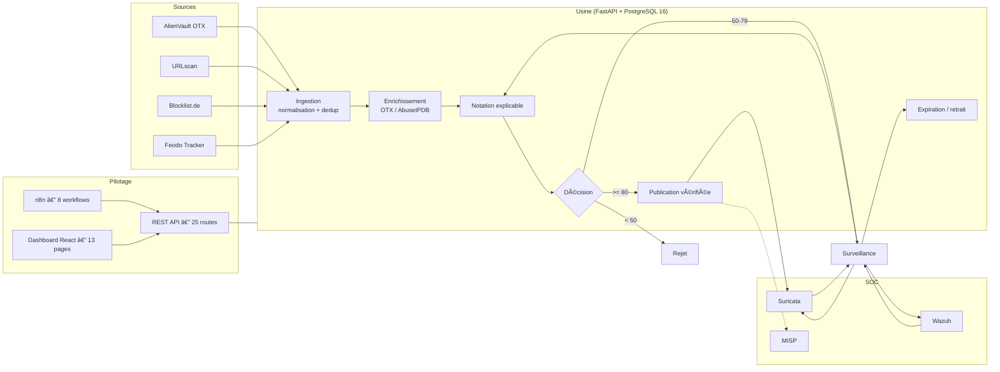

# SOAR IOC Factory

> Usine à indicateurs de compromission : **collecter → normaliser → dédupliquer →
> enrichir → noter → décider → publier → surveiller → expirer → retirer**,
> avec preuve, journal d'audit et tableau de bord SOC.

Projet 3 — plateforme SOAR de production d'IOC, livrée avec son automatisation
n8n, ses intégrations SOC (Suricata, Wazuh, MISP), son déploiement AWS et son
évaluation mesurée.

---

## Ce que fait la plateforme

| Étape | Ce qui se passe réellement | Preuve |
|---|---|---|
| **Collecte** | 4 collecteurs actifs (OTX, URLscan, Blocklist.de, Feodo Tracker) + collecteur synthétique de laboratoire | `audit_logs.action='COLLECT'` |
| **Normalisation** | validation stricte (IP, domaine, URL, MD5/SHA1/SHA256), forme canonique unique | `app/services/normalization.py` |
| **Déduplication** | empreinte SHA-256 `TYPE:value`, doublons reliés par `duplicate_of` | taux mesuré : **16,6 %** |
| **Enrichissement** | OTX + AbuseIPDB, cache 24 h, erreurs jamais transformées en verdict | **139** IOC enrichis |
| **Notation** | 5 composantes pondérées + pénalités faux positifs, **explication stockée** | `score_breakdown`, 100 % des scores |
| **Décision** | ≥ 80 publier · 50-79 surveiller · < 50 rejeter | seuils configurables |
| **Publication** | écriture puis **relecture** avant de marquer « vérifié » | `publications.status` |
| **Surveillance** | alertes Suricata / Wazuh rapprochées de l'inventaire | 16 détections réelles |
| **Expiration / retrait** | révocation confirmée avant de passer `REMOVED` | cycle complet mesuré : **34,2 min** |
| **Traçabilité** | journal **append-only** protégé par trigger PostgreSQL | 27 tests de sécurité |

Rien n'est inventé : si un fournisseur échoue, l'erreur est conservée et
affichée ; si une donnée n'a pas pu être mesurée, la documentation le dit.

---

## Chiffres au 14/11/2026

Source de vérité : [`reports/evaluation/metrics.json`](reports/evaluation/metrics.json).

| Indicateur | Valeur mesurée |
|---|---|
| Indicateurs en base | **174** (93 domaines, 56 IP, 24 hachages, 1 URL) |
| Scores calculés | **174 / 174** (100 %) |
| Score moyen / médian | **51,9 / 52** (min 37, max 82) |
| Décisions | 1 publier · 89 surveiller · 83 rejeter |
| Doublons écartés | **35** (taux de dédup **16,6 %**) |
| Enrichissements | **149** résultats sur **139** IOC (79,9 %) |
| Détections rapprochées | **16** (Suricata 2, Wazuh 4, manuel 10) |
| Latence à chaud (ingestion → score) | **43,8 s** par lot, **1,48 IOC/s** |
| Réduction du temps de traitement | **×23,3** (modèle manuel explicite, voir limites) |
| Tests automatisés | **177** (dont 27 de sécurité) |

> Le facteur ×23,3 compare la plateforme mesurée à un **modèle manuel posé
> comme hypothèse** (17 min/IOC), pas à un historique réel. L'hypothèse est
> détaillée et modifiable dans `scripts/evaluate_platform.py`.

---

## Architecture



Détail complet : [`docs/ARCHITECTURE.md`](docs/ARCHITECTURE.md).

---

## Démarrage rapide (local, ≈ 2 minutes)

Prérequis : Docker Desktop, Python 3.11, Node 20+.

```powershell
# 1. Socle : PostgreSQL + API + n8n
docker compose --profile n8n up -d

# 2. Vérifications
Invoke-RestMethod http://127.0.0.1:8000/health
Invoke-RestMethod http://127.0.0.1:8000/api/v1/system/health

# 3. Tableau de bord
cd frontend
npm install      # une seule fois
npm run dev      # -> http://127.0.0.1:5173/
```

| Accès | URL |
|---|---|
| Dashboard SOC (13 pages) | <http://127.0.0.1:5173/> |
| API + Swagger | <http://127.0.0.1:8000/docs> |
| n8n (8 workflows) | <http://127.0.0.1:5678> |

Procédure détaillée (installation, AWS, fermeture, pièges connus) :
[`OUVRIR_LE_PROJET.md`](OUVRIR_LE_PROJET.md) et
[`docs/INSTALLATION.md`](docs/INSTALLATION.md).

---

## Captures

| # | Écran | Fichier |
|---|---|---|
| 1 | Audit de l'environnement (Phase 0) | `capture/01-phase0-audit-environnement.jpg` |
| 2 | Socle API (Phase 2) | `capture/02-phase2-swagger-socle.jpg` |
| 3 | Tests au vert (Phase 3) | `capture/03-phase3-tests-104-verts.jpg` |
| 4 | Cycle de vie démontré | `capture/04-phase3-cycle-de-vie-demo.jpg` |
| 5 | Automatisation n8n (Phase 4) | `capture/05-phase4-n8n-automatisation.jpg` |
| 6 | Intégration SOC (Phase 5) | `capture/06-phase5-integration-soc.jpg` |
| 7 | Dashboard général | `capture/07-dashboard-general.jpg` |
| 8 | Graphiques du dashboard | `capture/07b-dashboard-graphiques.jpg` |
| 9 | Classement par score | `capture/08-scoring-classement.jpg` |
| 10 | Détail explicatif d'un score | `capture/08b-scoring-detail-explicatif.jpg` |
| 11 | Fiche IOC | `capture/09-ioc-detail.jpg` |
| 12 | Cycle de vie d'un IOC | `capture/09b-ioc-cycle-de-vie.jpg` |
| 13 | Santé système | `capture/10-system-health.jpg` |
| 14 | Déploiement AWS | `capture/11-aws-dashboard-ec2.jpg` |

---

## Documentation

| Document | Contenu |
|---|---|
| [`OUVRIR_LE_PROJET.md`](OUVRIR_LE_PROJET.md) | Ouvrir / fermer le projet (local + AWS) |
| [`docs/ARCHITECTURE.md`](docs/ARCHITECTURE.md) | Conception, modèle de données, choix techniques |
| [`docs/INSTALLATION.md`](docs/INSTALLATION.md) | Installation reproductible, configuration, dépannage |
| [`docs/WORKFLOWS.md`](docs/WORKFLOWS.md) | Les 8 workflows n8n, import, exécution, vérification |
| [`docs/SECURITY.md`](docs/SECURITY.md) | Modèle de menace, contrôles, preuves, limites |
| [`docs/TESTING.md`](docs/TESTING.md) | Stratégie de test, 177 tests, ce qui n'est pas couvert |
| [`docs/USER_GUIDE.md`](docs/USER_GUIDE.md) | Utilisation du dashboard et de l'API |
| [`docs/AWS_DEPLOYMENT.md`](docs/AWS_DEPLOYMENT.md) | Déploiement EC2, coûts, accès par tunnel |
| [`docs/PHASE0_AUDIT.md`](docs/PHASE0_AUDIT.md) | Audit initial de l'environnement |
| [`reports/evaluation/EVALUATION.md`](reports/evaluation/EVALUATION.md) | Évaluation Phase 7 (métriques + graphiques) |
| [`reports/RAPPORT_SOAR_IOC_FACTORY.docx`](reports/RAPPORT_SOAR_IOC_FACTORY.docx) | Rapport Word pour le jury (version courte) |
| [`reports/RAPPORT_FINAL.docx`](reports/RAPPORT_FINAL.docx) | Rapport final complet : 19 chapitres + 5 annexes, 22 figures |

---

## Structure du dépôt

```
backend/            API FastAPI, moteur, tests (177)
  app/api/          25 routes REST
  app/services/     ingestion, normalisation, pipeline, MISP
  app/scoring/      moteur de notation explicable
  app/lifecycle/    machine à états
  app/collectors/   OTX, URLscan, Blocklist.de, Feodo, synthétique
  app/enrichment/   OTX, AbuseIPDB, agrégation + cache
  app/integrations/ Suricata, Wazuh, MISP
  tests/            9 modules de tests
database/           schéma SQL + migrations Alembic
frontend/           React 19 + TypeScript + Tailwind 4 + Recharts 3
infrastructure/     Dockerfiles, scripts AWS idempotents
integrations/       règles Suricata, décodeurs Wazuh, client MISP
workflows/n8n/      8 workflows exportés (importables)
scripts/            génération, évaluation, rapport, purge
docs/               documentation
reports/            rapport Word, évaluation, figures
capture/            14 captures d'écran
```

---

## Sécurité (résumé)

- **Aucun port exposé publiquement** : toutes les publications Docker sont sur
  `127.0.0.1` ; sur EC2, accès **uniquement par tunnel SSH** (vérifié 4 façons).
- **SSH restreint à l'IP de l'administrateur** (`/32`) depuis le 14/11/2026 ; la
  règle `0.0.0.0/0` du security group a été retirée après vérification
  (`docs/AWS_DEPLOYMENT.md` §2.2).
- **Secrets hors du dépôt** : `.env`, `*.pem`, clés AWS ignorés par git ;
  test automatisé qui vérifie qu'aucun secret n'est suivi.
- **Journal d'audit append-only** : trigger PostgreSQL qui refuse UPDATE/DELETE.
- **Entrées hostiles rejetées** : validation stricte, aucune concaténation SQL.
- **Aucune affirmation non vérifiée** : une publication n'est marquée vérifiée
  qu'après relecture ; une révocation n'est acceptée qu'après confirmation.
- **Aucune infrastructure réelle bloquée** : les IOC sont publiés vers une liste
  de détection de laboratoire, jamais vers un pare-feu de production.

Détail et limites assumées : [`docs/SECURITY.md`](docs/SECURITY.md).

---

## Limites connues

1. **Clé abuse.ch refusée** (`unknown_auth_key`) : URLhaus / ThreatFox /
   MalwareBazaar sont câblés mais **inactifs**. Aucune donnée n'a été simulée
   pour compenser.
2. **MISP** : client REST complet + tests mockés ; serveur non déployé (images
   officielles non disponibles anonymement). L'endpoint répond honnêtement
   `skipped` tant que `MISP_URL` / `MISP_KEY` sont absents.
3. **Précision / rappel** : pas de vérité terrain annotée (les IOC viennent de
   flux publics) ; seuls des proxys mesurables sont revendiqués.
4. **API sans authentification** : assumé pour un laboratoire fermé sur
   `127.0.0.1` ; à ajouter avant tout usage multi-utilisateur.

---

## Régénérer les livrables

```powershell
# Métriques + graphiques + EVALUATION.md (lit la base réelle)
.\backend\.venv\Scripts\python.exe scripts\evaluate_platform.py

# Rapport Word du jury (métriques live + figures + captures)
.\backend\.venv\Scripts\python.exe scripts\generate_report.py

# Rapport final complet (page de garde, sommaire, 32 tableaux, 22 figures)
.\backend\.venv\Scripts\python.exe scripts\build_final_report.py

# Procédure de démarrage en Word
.\backend\.venv\Scripts\python.exe scripts\md_to_docx.py OUVRIR_LE_PROJET.md "reports\PROCEDURE_OUVRIR_LE_PROJET.docx"

# Tests (177)
cd backend
$env:PYTHONPATH="$PWD"; $env:POSTGRES_HOST="127.0.0.1"; $env:POSTGRES_USER="soar"
$env:POSTGRES_PASSWORD=(Select-String -Path ..\.env -Pattern '^POSTGRES_PASSWORD=(.+)$').Matches[0].Groups[1].Value
.\.venv\Scripts\python.exe -m pytest tests -q
```

---

*Projet académique — les données collectées proviennent de flux publics de
threat intelligence. Les indicateurs synthétiques éventuels portent
`is_synthetic = true`.*
