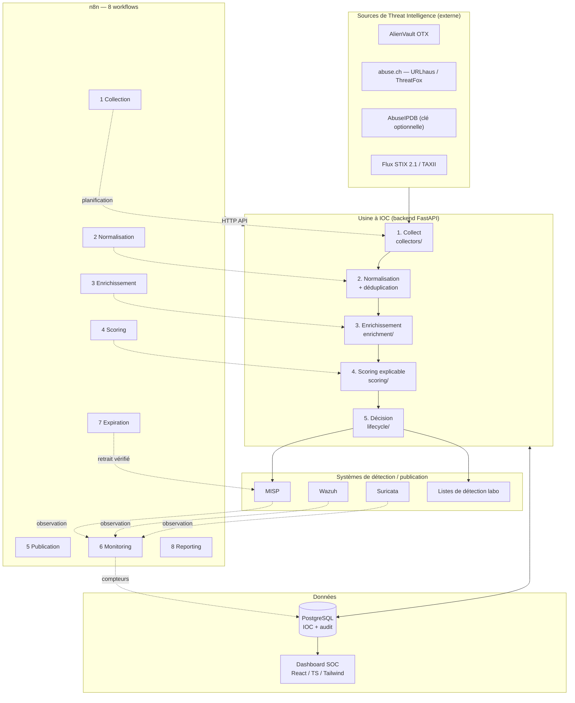
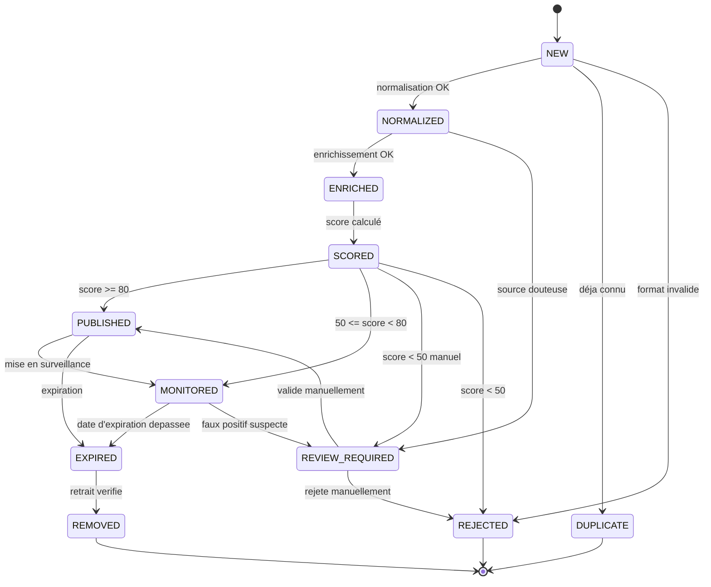
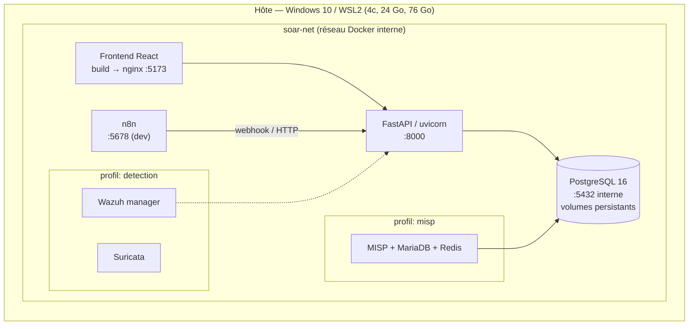

# SOAR IOC Factory — Architecture

> Projet 3 — *Usine à indicateurs : le cycle de vie des IOC*.
> Plateforme SOAR de gestion intelligente et automatisée du cycle de vie des IOC.

## 1. Vision d'ensemble



## 2. Cycle de vie de l'IOC



**Règles :**
- Chaque transition → **une ligne dans `lifecycle_events`** (auteur : système ou utilisateur, horodatage, raison, score avant/après).
- L'expiration est automatique et **vérifiée** (retrait confirmé côté MISP/listes avant le statut `REMOVED`).

## 3. Moteur de score (explicable et configurable)

Formule en **composantes pondérées**, chaque composante produit un sous-score et une explication conservée en base :

```
score = clamp(0, 100,
    w_source    * source_reliability        # 0..100 (table de confiance des sources)
  + w_freshness * freshness(age)            # décroissance exponentielle, demi-vie configurable
  + w_multi     * independent_sources(n)    # log(1+n)/log(1+N_max)
  + w_enrich    * enrichment_agreement      # consensus des enrichissements
  + w_detect    * observed_detections(n)    # saturation log
  - penalty_fp  * known_false_positives     # pénalité linéaire
)
```

- **Anti-collusion** : les sources sont regroupées par `provenance_group` (ex. plusieurs flux qui republient OTX = 1 source indépendante).
- **Décroissance temporelle** : demi-vie par type d'IOC (configurable), un IOC jamais revu perd de la confiance.
- **Seuils (valeurs initiales, testables)** : `>= 80` publication auto · `50–79` surveillance · `< 50` rejet/quarantaine · expiré → retrait.
- Chaque score stocke son **détail JSON** (`score_breakdown`) → le dashboard affiche *pourquoi*.

## 4. Architecture technique



**Principes :**
- **Profils Docker** : socle (`api`, `db`, `fe`) par défaut ; `n8n`, `misp`, `detection` activés à la demande → mémoire maîtrisée.
- PostgreSQL **jamais publié sur l'hôte public** : port mappé sur `127.0.0.1` uniquement.
- Secrets uniquement via `.env` (ignoré par Git, `.env.example` versionné).
- Healthchecks sur tous les services ; API : `/health`, `/ready`.

## 5. Structure du dépôt

```
soar-ioc-factory/
├── backend/
│   ├── app/
│   │   ├── api/          # routes HTTP (ioc, sources, scoring, lifecycle, audit…)
│   │   ├── core/         # config, sécurité, logs, dépendances
│   │   ├── models/       # SQLAlchemy
│   │   ├── schemas/      # Pydantic
│   │   ├── services/     # orchestration métier
│   │   ├── collectors/   # OTX, abuse.ch, STIX/TAXII
│   │   ├── enrichment/   # agrégation des enrichissements
│   │   ├── scoring/      # moteur de score
│   │   ├── lifecycle/    # machine à états
│   │   └── integrations/ # MISP, Wazuh, Suricata
│   └── tests/
├── frontend/             # React + TS + Tailwind + Recharts
├── workflows/n8n/        # 8 workflows exportés en JSON
├── integrations/         # configs MISP / Wazuh / Suricata
├── database/migrations/  # schema + versions
├── infrastructure/
│   ├── docker/           # Dockerfiles + compose profiles
│   └── aws/              # scripts reproductibles (Phase 8)
├── scripts/
├── reports/              # rapports générés
├── docs/                 # documentation FR
├── capture/              # captures d'écran (preuves, démo)
├── docker-compose.yml
├── .env.example
├── .gitignore
└── README.md
```

## 6. Plan de développement (phases)

| Phase | Contenu | Livrable vérifiable |
|---|---|---|
| 0 ✅ | Audit environnement | `docs/PHASE0_AUDIT.md` |
| 1 | Conception | ce fichier + `database/schema.sql` + arborescence |
| 2 | Socle : FastAPI + PostgreSQL + Docker + healthchecks | `docker compose up` vert, `GET /health` |
| 3 | Moteur IOC : collecte → normalisation → dédup → enrichissement → scoring → cycle de vie | API + tests unitaires verts |
| 4 | n8n + 8 workflows exportés en JSON | workflows importables, erreurs gérées |
| 5 | MISP + Wazuh + Suricata + observation des détections | publication/retrait vérifiés |
| 6 | Dashboard 12 pages, données réelles | SPA connectée à la base |
| 7 | Tests unitaires / intégration / sécurité / E2E + métriques | `TESTING.md` + résultats mesurés |
| 8 | AWS (après vérification Learner Lab, sans création non autorisée) | `AWS_DEPLOYMENT.md` + coûts estimés |
| 9 | Documentation finale + démonstration | 8 fichiers docs + scénario démo |

## 7. Politique de sécurité

- Authentification (JWT) + rôles (`admin`, `analyst`, `viewer`) ; endpoints protégés, validation Pydantic, ORM paramétré (anti-injection).
- Journal d'audit **append-only** pour toute action (collecte, publication, retrait, config).
- **Interdit sans autorisation explicite** : blocage réseau réel, suppression de ressources, création de ressources payantes AWS, exposition de service sur Internet.
- Laboratoire isolé : publications vers MISP/listes de **démonstration uniquement**.
