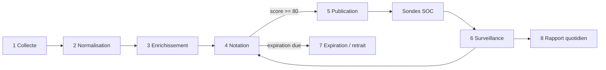

# Automatisation n8n — les 8 workflows

> L'usine est pilotée par 8 workflows exportés dans `workflows/n8n/`.
> Chaque workflow appelle **une seule route REST idempotente** de l'API :
> n8n orchestre, l'API décide. Aucune logique métier ne vit dans n8n.

---

## 1. Vue d'ensemble

| # | Workflow | Fichier | Fréquence | Route appelée |
|---|---|---|---|---|
| 1 | IOC Collection | `01-ioc-collection.json` | toutes les 30 min | `POST /iocs/collect/run?limit=50` |
| 2 | IOC Normalization | `02-ioc-normalization.json` | toutes les 30 min | `POST /iocs/normalize/run?limit=200` |
| 3 | IOC Enrichment | `03-ioc-enrichment.json` | toutes les heures | `POST /iocs/enrich/run?limit=50` |
| 4 | IOC Scoring | `04-ioc-scoring.json` | toutes les 30 min | `POST /iocs/scoring/run` |
| 5 | IOC Publication | `05-ioc-publication.json` | toutes les heures | `POST /iocs/publish/run?limit=100` |
| 6 | IOC Monitoring | `06-ioc-monitoring.json` | toutes les 15 min | `POST /iocs/detections/ingest` (×2) + `GET /iocs/detections/recent` |
| 7 | IOC Expiration | `07-ioc-expiration.json` | toutes les heures | `POST /iocs/expire/run` puis `POST /iocs/remove/run` |
| 8 | IOC Reporting | `08-ioc-reporting.json` | tous les jours à 06:00 | `POST /reports/daily` |

Base URL dans les workflows : `http://soar-api:8000/api/v1`
(réseau Docker interne `soar-net` — l'API n'est jamais appelée par Internet).

Chaque workflow contient aussi un **Manual Trigger** : indispensable pour
l'exécution en ligne de commande (voir §5).

---

## 2. Chaîne fonctionnelle



L'ordre n'est pas garanti par n8n (chaque workflow est indépendant) : c'est
**voulu**. Chaque étape est idempotente et rattrape son retard au tour suivant.
Un workflow 3 qui tourne avant le workflow 1 ne casse rien : il ne trouve
simplement aucun IOC `NORMALIZED` à enrichir.

---

## 3. Détail des workflows

### 3.1 Collecte — `01-ioc-collection.json`

- **Nœuds** : Schedule Trigger (30 min) → HTTP `collect/run?limit=50` → note Doc.
- **Ce que fait l'API** : interroge OTX, URLscan, Blocklist.de, Feodo Tracker ;
  isole les pannes par source ; ingère, normalise et déduplique chaque élément.
- **Réponse** : `{ totals: {created, updated, duplicates, rejected, failed},
  sources: [...] }`.
- **Échec partiel** : une source morte n'empêche pas les autres ; l'échec est
  journalisé (`action='COLLECT'`, `success=false`, `error=...`).

### 3.2 Normalisation / réconciliation — `02-ioc-normalization.json`

- Ré-ingère les enregistrements restés `NEW` (import manuel, reprise après
  panne) via **le même code** que l'ingestion : mêmes règles, même dédup.
- Vérifie explicitement qu'il ne reste aucun `NEW` : `remaining_new` est renvoyé.

### 3.3 Enrichissement — `03-ioc-enrichment.json`

- Prend jusqu'à 50 IOC `NORMALIZED`, interroge OTX puis AbuseIPDB (IP seules).
- Cache 24 h par couple (IOC, fournisseur).
- Un fournisseur en erreur est **ignoré, pas transformé en verdict** ; l'IOC
  ne passe à `ENRICHED` que si au moins un verdict réel a été obtenu.

### 3.4 Notation — `04-ioc-scoring.json`

- Note tous les IOC `ENRICHED` (jusqu'à 500), persiste le détail explicatif,
  applique la décision : `publish` / `monitor` / `reject`.
- Un IOC déjà publié qui reste au-dessus du seuil voit simplement son score
  rafraîchi (pas de re-publication).
- Une redescente `PUBLISHED → REJECTED` passe obligatoirement par
  `REVIEW_REQUIRED` : jamais de dépublication silencieuse.

### 3.5 Publication — `05-ioc-publication.json`

- Cible actuelle : **liste de détection locale** (`detection_list`).
- **Vérification** : la publication est réécrite en base puis relue ; elle n'est
  marquée `verified` que si la relecture confirme son existence.
- MISP est un second segment (`POST /iocs/publish/misp/run`) : sans
  `MISP_URL`/`MISP_KEY`, la réponse est `{"status":"skipped"}` — jamais un faux succès.

### 3.6 Surveillance — `06-ioc-monitoring.json`

- Lit `eve.json` (Suricata) et `alerts.json` (Wazuh) exposés en lecture seule
  au conteneur API.
- Ne rapproche que les valeurs **présentes dans l'inventaire** ; une alerte
  inconnue est comptée `untracked`, jamais insérée silencieusement.
- Déduplique les alertes identiques (IOC, capteur, règle, minute).

### 3.7 Expiration / retrait — `07-ioc-expiration.json`

Deux étapes, dans cet ordre :

1. `expire/run` : passe à `EXPIRED` tout IOC dont `expires_at` est dépassé.
2. `remove/run` : révoque **toutes** les publications actives, vérifie par
   relecture qu'il n'en reste aucune, puis seulement passe à `REMOVED`.
   Si une révocation distante (MISP) n'est pas confirmée, l'IOC **reste**
   `EXPIRED` et l'échec est reporté.

### 3.8 Rapport — `08-ioc-reporting.json`

- Calcule le rapport du jour depuis la base (totaux, qualité, sources,
  distribution des scores) et l'enregistre dans `reports`.
- Rejouable : le rapport du même jour est mis à jour, pas dupliqué.

---

## 4. Importer les workflows

### Via l'interface

1. Ouvrir <http://127.0.0.1:5678>.
2. **Workflows → Import from File**.
3. Importer les 8 fichiers `workflows/n8n/0*.json`.
4. Activer chaque workflow (interrupteur *Active*).

### Via la CLI n8n

```powershell
docker exec soar-n8n n8n import:workflow --input=/data/n8n/01-ioc-collection.json
```

Les identifiants de workflow sont **stables** (générés par
`scripts/generate_n8n_workflows.py`) : réimporter met à jour le workflow
existant au lieu de créer un doublon.

Régénérer les fichiers après une modification de l'API :

```powershell
.\backend\.venv\Scripts\python.exe scripts\generate_n8n_workflows.py
```

---

## 5. Exécuter un workflow en ligne de commande

Contrainte réelle de n8n 2.46 : `n8n execute --id=<id>` n'accepte que les
nœuds de type **Manual Trigger** comme point d'entrée. C'est pourquoi chaque
export en contient un.

```powershell
# Conteneur éphémère sur le réseau de la stack (le conteneur n8n n'a pas la CLI exposée)
docker run --rm --network soar-ioc-factory_soar-net `
  -v "${PWD}\workflows\n8n:/data/n8n:ro" `
  n8nio/n8n:latest execute --id=m2O4V96oGzkZaiJl
```

| Workflow | ID |
|---|---|
| 1 — Collection | `m2O4V96oGzkZaiJl` |
| 2 — Normalisation | `jrbz74vokPzB9sNZ` |
| 3 — Enrichissement | `QxkfSR8uABSHOrOZ` |
| 4 — Notation | `ZjwJnGnWxeQoO8PS` |
| 5 — Publication | `LqNcTCKxsoZl7Nkt` |
| 6 — Surveillance | `FxFcs5nNMkJeXKEf` |
| 7 — Expiration | `WCbwNKVMvYur4pDq` |
| 8 — Rapport | `BcgzzjDErMHIM05i` |

Les 8 workflows ont été exécutés avec succès sur la plateforme réelle
(capture `capture/2026-11-17/console-09-automation.png`).

---

## 6. Idempotence et reprise

| Situation | Comportement |
|---|---|
| Workflow rejoué immédiatement | aucun doublon : dédup par empreinte, publication déjà existante détectée |
| API momentanément indisponible | le tour suivant rattrape (chaque étape filtre sur un statut) |
| Source de collecte en panne | les autres sources continuent, l'échec est audité |
| Enrichissement en erreur | l'IOC reste `NORMALIZED`, retenté au tour suivant |
| Expiration sans publication | `REMOVED` direct après vérification qu'il n'y a rien à révoquer |
| Révocation MISP non confirmée | l'IOC reste `EXPIRED` (jamais de `REMOVED` mensonger) |

---

## 7. Variables et sécurité

- Aucun credential n8n n'est utilisé : les workflows appellent l'API interne
  en HTTP sur le réseau Docker, sans authentification (API liée à `127.0.0.1`
  côté hôte).
- `N8N_DIAGNOSTICS_ENABLED=false` : pas de télémétrie.
- `N8N_ENCRYPTION_KEY` provient de `.env` (jamais commité).
- n8n n'est pas exposé publiquement : `127.0.0.1:5678` uniquement.

---

## 8. Vérifier que l'automatisation a tourné

```powershell
# Résumé des workflows vu par l'API
Invoke-RestMethod http://127.0.0.1:8000/api/v1/workflows/summary

# Dernières actions d'audit
Invoke-RestMethod "http://127.0.0.1:8000/api/v1/audit?limit=20"
```

Le dashboard expose les mêmes données : page **Workflows** (`/workflows`) et
page **Journal d'audit** (`/audit`).
